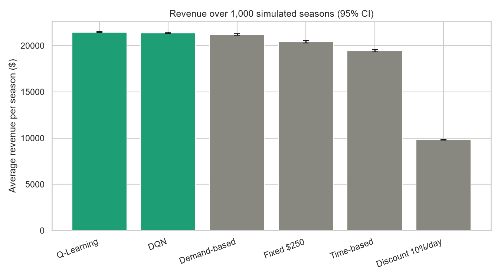
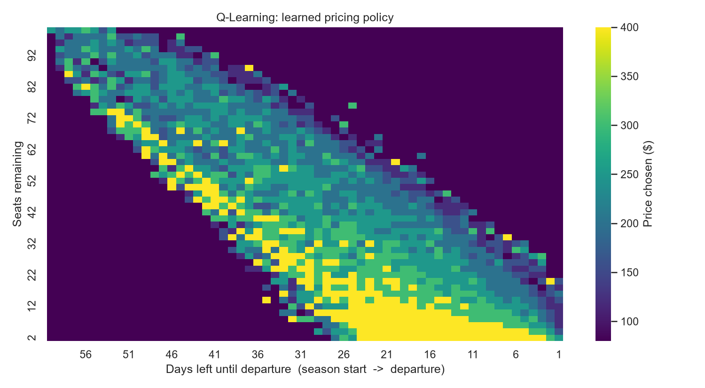

# Dynamic Pricing with Reinforcement Learning

An autonomous pricing agent that learns, by trial and error in a simulated market, how to sell a
fixed inventory (airline seats) before departure. It is compared against rule-based pricing
strategies and wrapped in a Revenue Manager dashboard.

**Live demo:** https://smart-pricing-rl.streamlit.app/

## The problem
Selling finite, perishable inventory (flight seats, hotel rooms) is hard: price too high and seats go
unsold; price too low and they sell out early at a poor price. A static rule cannot react to how
many seats are left or how close departure is. This project treats pricing as a sequential
decision problem and learns the policy with reinforcement learning.

## How it works
**Environment** (`src/envs/pricing_env.py`, a custom Gymnasium env)

| | |
|---|---|
| State | `[remaining_inventory, days_until_departure]` |
| Action | one of 7 price levels: $80, 120, 160, 200, 250, 300, 400 |
| Reward | revenue earned that day (price x seats sold) |
| Episode | one 60-day season for 100 seats; unsold seats are worth nothing |
| Demand | Poisson bookings. The mean falls exponentially as price rises (elasticity 1.5) and ramps from 0.6x to 1.4x as departure nears |

**Agents**
- **Baselines** (`src/agents/baselines.py`): fixed price, 10% daily discount, time-based schedule, demand-based rule
- **Tabular Q-learning** (`src/agents/q_learning.py`): epsilon-greedy, learning rate that decays per state-action pair, 300k training seasons
- **DQN** (`src/agents/dqn.py`): neural network with experience replay, a target network, Double-DQN targets, and best-checkpoint selection

## Results
1,000 simulated seasons per agent (`python scripts/evaluate.py`):

| Agent | Avg revenue | Unsold seats | vs best baseline |
|---|---|---|---|
| **Q-Learning** | **$21,469** | 0.6 | +1.2% |
| **DQN** | **$21,387** | 2.1 | +0.8% |
| Demand-based | $21,208 | 0.1 | n/a |
| Fixed $250 | $20,426 | 18.3 | -3.7% |
| Time-based | $19,450 | 9.2 | -8.3% |
| Discount 10%/day | $9,827 | 0.0 | -53.7% |




The learned policy discovers scarcity pricing on its own: few seats and plenty of time lead to high
prices, while many seats and little time lead to discounts.

## Dashboard
`streamlit run app.py` opens a Revenue Manager view with adjustable **price floor and ceiling**
(safety bounds applied to every agent), a single-season simulator, a multi-season strategy
comparison, and the learned policy map. Under tighter bounds (for example $80-$250) the RL
advantage grows to about +3.5%.

## Run it yourself
```bash
conda create -n pricing-rl python=3.11 -y && conda activate pricing-rl
pip install -r requirements-train.txt

python src/envs/pricing_env.py        # environment sanity test
python scripts/run_baselines.py       # baseline results
python scripts/train_qlearning.py     # trains and saves models/q_table.npy
python scripts/train_dqn.py           # trains and saves models/dqn.pt
python scripts/evaluate.py            # 1,000-season comparison and figures
streamlit run app.py                  # dashboard
```

## Project structure
```
app.py                  Streamlit dashboard
src/envs/               Gymnasium pricing environment
src/agents/             baselines, Q-learning, DQN
src/utils/              evaluation helpers
scripts/                training and evaluation entry points
models/                 trained Q-table and DQN weights
results/                summary table and figures
```

## Limitations
- Demand is **simulated**. The gains show the method works in this market model, not that it
  would earn the same on real booking data.
- The improvement over the best heuristic is modest (about 1%). The demand-based rule is already strong here.
- The Q-table policy is somewhat jumpy day to day, and states never visited in training have no
  learned policy. A production system would smooth prices and fall back on a rule there.
- On a state space this small the Q-table matches or beats the DQN. The DQN's advantage is that it
  scales to continuous and larger state spaces.

## Possible extensions
Competitor prices in the state, exact optimal benchmark via dynamic programming, price-change
smoothing, and calibrating the demand model on real booking data.